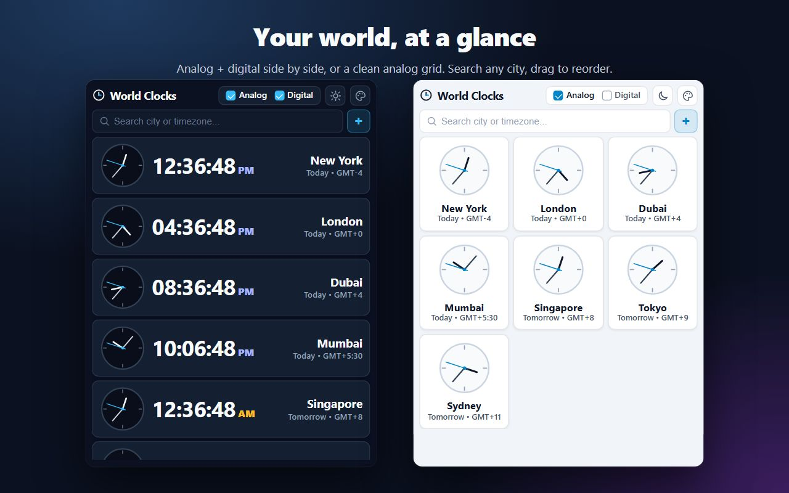
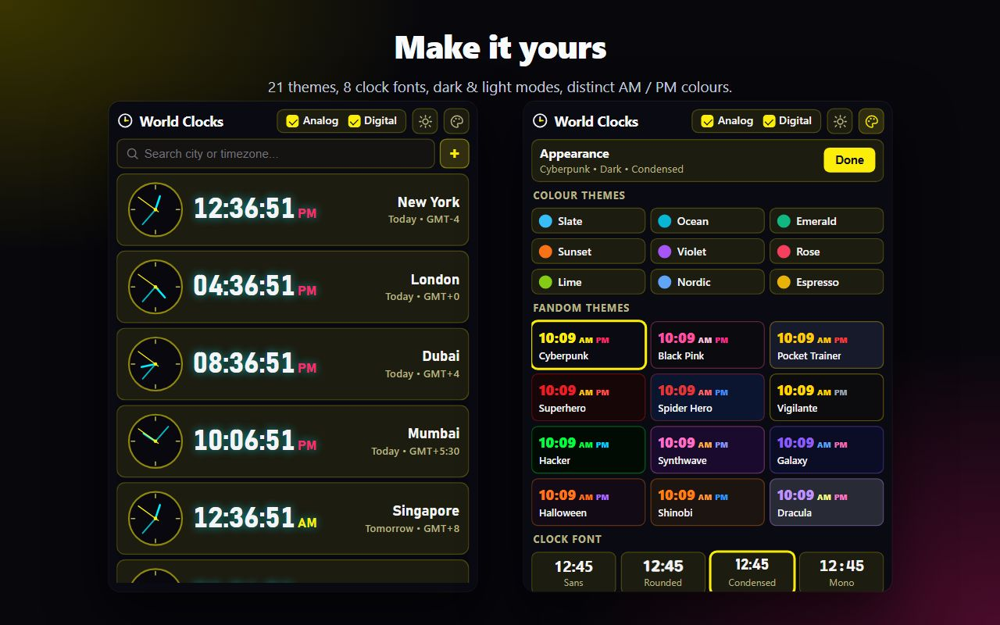

<p align="center">
  
</p>

<h1 align="center">World Clocks - Chrome Extension (Manifest V3)</h1>

A minimalistic, zero-dependency Chrome Extension for viewing multiple world timezones at a glance. Features side-by-side simple Analog (HMS hands) and Digital (`00:00:00 AM/PM`) clocks, a responsive Analog-only grid layout, live city search with `+` / red `×` actions, hidden scrollbars, and Dark/Light theme support.

## Screenshots





---

## Features

- **Popup World Clock List**: Click the extension icon to open a clean dropdown popup of all your configured clocks.
- **Search & Instant Add/Remove**:
  - Search by city name, country, or IANA timezone (e.g., `Tokyo`, `London`, `New York`, `Mumbai`, `UTC`).
  - Shows a **`+`** icon on the side to add a city, or a **red `×`** icon if the clock is already added (clicking removes it).
- **Side-by-Side Analog & Digital Modes**:
  - **Analog**: Minimalist clock face with Hour, Minute, and Second (`HMS`) hands.
  - **Digital**: Crisp `00:00:00 AM/PM` tabular display with relative day and GMT offset subtitle (`Today • GMT+5:30`).
- **Mode Checkboxes with Guardrail**:
  - Toggle `Analog` or `Digital` on/off independently.
  - Enforces that **at least one mode remains selected** at all times.
- **Responsive Analog Grid**:
  - When only `Analog` mode is selected, clocks automatically arrange into a responsive multi-column grid.
- **Dark & Light Themes**:
  - Instant theme toggle button in the header; works seamlessly across all modes and persists automatically.
- **Appearance Panel** (palette button):
  - 9 colour themes, 12 fandom-inspired themes, and 8 clock fonts; AM and PM use distinct colours.
- **Reorder Clocks**:
  - Press and hold a clock for 1 second, then drag it to a new position (order is saved).
- **Hidden Scrollbars**:
  - Smooth vertical scrolling when your clock list grows long, with scrollbars completely hidden.

---

## Project Structure

```text
World Clocks/
├── manifest.json              # Chrome Extension Manifest V3 configuration
├── package.json               # Helper scripts for icon generation, validation, and packaging
├── assets/
│   └── icons/
│       ├── icon.svg           # Vector source icon
│       ├── icon-16.png        # 16x16 toolbar icon
│       ├── icon-32.png        # 32x32 retina toolbar icon
│       ├── icon-48.png        # 48x48 extensions page icon
│       └── icon-128.png       # 128x128 Chrome Web Store icon
├── src/
│   └── popup/
│       ├── popup.html         # Popup UI structure
│       ├── popup.css          # Dark/Light themes, hidden scrollbars, and responsive grid
│       ├── popup.js           # UI controller, search +/× handlers, mode guardrail, 1s ticker
│       ├── timezones.js       # Curated city catalog + Intl timezone & angle calculations
│       ├── themes.js          # Colour/fandom theme and font catalog
│       └── storage.js         # chrome.storage.sync persistence with localStorage fallback
├── scripts/
│   ├── generate-icons.js      # Zero-dependency PNG icon generator
│   ├── validate.js            # Pre-publish manifest and asset validator
│   └── package.ps1            # Builds clean ZIP archive in dist/ for Chrome Web Store
├── docs/
│   ├── STORE_LISTING.md       # Chrome Web Store copy, permission justification, & steps
│   └── PRIVACY_POLICY.md      # Privacy policy for Chrome Web Store compliance
├── CONTRIBUTING.md            # Developer guide & architecture reference
├── CHANGELOG.md               # Release history
├── LICENSE                    # MIT License
├── .editorconfig              # Consistent coding style across editors
└── .gitignore                 # Git ignore rules
```

---

## Getting Started (Load Unpacked in Chrome)

1. Open Google Chrome and navigate to `chrome://extensions/`.
2. Enable **Developer mode** using the toggle in the top-right corner.
3. Click **Load unpacked** in the top-left corner.
4. Select this project root folder (`World Clocks`).
5. Click the **Extensions** puzzle icon in Chrome's toolbar, pin **World Clocks**, and click its icon to open the popup.

---

## Development & Publishing Scripts

Validate manifest and required assets:
```bash
npm run validate
```

Regenerate PNG icons (`16`, `32`, `48`, `128`) from `scripts/generate-icons.js`:
```bash
npm run icons
```

Create the production `.zip` archive ready for the Chrome Web Store:
```bash
npm run pack
```
This creates `dist/world-clocks-extension.zip` containing only the production files (`manifest.json`, `src/`, `assets/`). See [docs/STORE_LISTING.md](docs/STORE_LISTING.md) for the complete Chrome Web Store submission guide.
